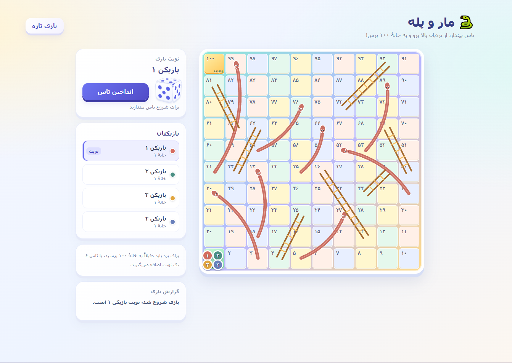

# 🐍 مار و پله
<div align="center">


</div>
<div align="right">
بازی مرورگری «مار و پله» با صفحهٔ مارپیچ ۱۰۰ خانه‌ای، تاس و انیمیشن حرکت. بازی تک‌نفره (با حریف کامپیوتری) یا تا چهار بازیکن انسانی را پشتیبانی می‌کند و همه‌چیز در یک فایل HTML جای گرفته است.
</div>

## 🎮 بازی کردن


**[همین حالا بازی کنید: اجرای آنلاین و تجربه بازی](https://iammfk.github.io/snakes-and-ladders/)**

<br/>

فایل `index.html` را در مرورگری که JavaScript در آن فعال است باز کنید — کافی است فایل را با دوبار کلیک یا کشیدن آن روی پنجرهٔ مرورگر اجرا کنید. نیازی به نصب، سرور محلی یا تنظیمات اضافی نیست.


### 🖼️ پیش‌نمایش بازی

<p align="center">
  
</p>


## 🕹️ نحوهٔ بازی

1. تعداد بازیکنان را از میان ۱ تا ۴ انتخاب کنید:
   - انتخاب ۱ بازیکن: یک بازیکن انسانی در برابر یک حریف کامپیوتری.
   - انتخاب ۲ تا ۴: همهٔ بازیکنان انسانی هستند.
2. نوبت خود را با کلیک (ماوس) یا لمس آغاز کنید؛ تاس می‌چرخد و نتیجهٔ ۱ تا ۶ را نشان می‌دهد.
3. مهره به‌صورت انیمیشنی روی صفحه حرکت می‌کند.

### 📏 قوانین

- حرکت مهره به اندازهٔ عدد تاس انجام می‌شود.
- اگر روی خانهٔ ابتدای نردبان بیفتید، تا خانهٔ انتهای آن بالا می‌روید.
- اگر روی سر مار بیفتید، تا دم آن پایین می‌آید.
- برای برد، باید دقیقاً روی خانهٔ ۱۰۰ فرود بیایید.
- آوردن عدد ۶ یک نوبت اضافه می‌دهد.


### 🔁 پایان بازی و شروع مجدد

با رسیدن دقیق یک بازیکن به خانهٔ ۱۰۰، پنجرهٔ برنده به همراه جلوهٔ کاغذرنگی (Confetti) نمایش داده می‌شود و می‌توانید با گزینهٔ «بازی مجدد» یا «بازی جدید» بازی را از نو آغاز کنید.

### 🖱️ کنترل‌ها

| عمل | ورودی |
| --- | --- |
| انداختن تاس / تأیید انتخاب‌ها | کلیک ماوس یا لمس  |

⚠️ کنترل صفحه‌کلید (کیبورد) در این بازی پیاده‌سازی نشده است.

## 💻 نیازمندی‌ها

- یک مرورگر وب با JavaScript فعال.
- هیچ نصب، وابستگی، سرور یا اتصال اینترنتی لازم نیست.

## 🛠️ راه‌اندازی برای توسعه

کل پروژه در یک فایل واحد است: HTML، CSS (درون‌خطی) و JavaScript (درون‌خطی) همگی در `index.html` قرار دارند. هیچ Package Manager، فایل قفل، فرآیند Build، تست یا پیکربندی CI وجود ندارد و نیازی به نصب هیچ چیز نیست.

1. فایل `index.html` را از [مخزن پروژه](https://github.com/IamMFK/snakes-and-ladders) دریافت کنید.
2. آن را در مرورگر باز کنید و ویرایش‌ها را اعمال کنید.
3. برای دیدن تغییرات، صفحه را در مرورگر تازه‌سازی (Reload) کنید.


### 🧱 ساختار پروژه

```text
index.html   # کل بازی: ساختار، استایل، منطق و گرافیک
```

گرافیک صفحه، تاس و کاغذرنگی با CSS/HTML و مسیرهای SVG درون همان فایل ساخته می‌شوند و فونت‌ها از فونت‌های سیستم استفاده می‌کنند. هیچ فایل خارجی CSS، JavaScript، تصویر، صدا یا فونتی بارگذاری نمی‌شود.
